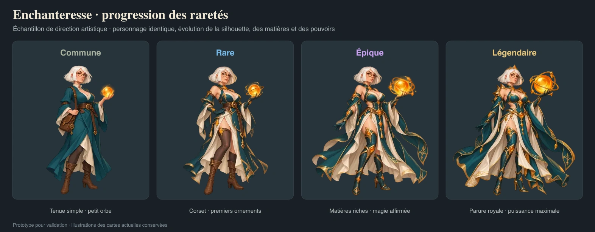
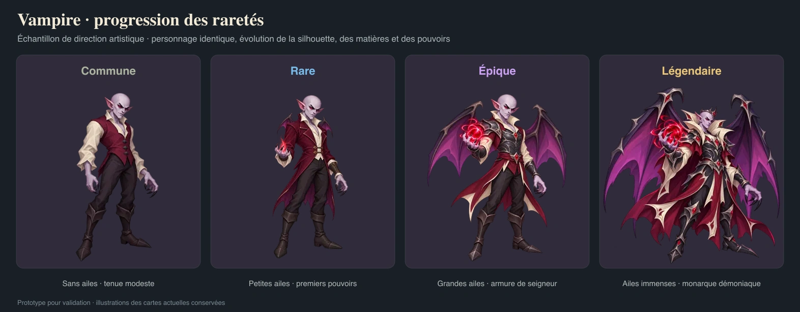

# Échantillon : progression des raretés

Deux personnages, quatre variantes chacun : **Commune → Rare → Épique → Légendaire**. Cet échantillon a été validé par l’utilisateur comme direction pour la progression du catalogue. La déclinaison finale varie davantage les poses, les expressions et les gabarits entre les raretés.

- **Enchanteresse** : même adulte d’environ 32 ans, carré blanc, lunettes rondes, palette sarcelle/ivoire/ambre et silhouette voluptueuse. La tenue devient plus sensuelle, les matières plus luxueuses, les ornements plus travaillés et l’orbe plus puissant avec la rareté.
- **Vampire** : même visage lilas et même palette bordeaux/ivoire/violet. Il est sans ailes en Commune, développe de petites ailes en Rare, de grandes ailes en Épique et une envergure de monarque démoniaque en Légendaire. L’armure, les bijoux et les pouvoirs se développent aussi.

Les silhouettes et les grandes masses de couleur restent lisibles. Le détail revient surtout sur les tissus, les pièces d’armure, les gemmes et les accessoires des dernières raretés ; les fonds restent calmes.

Les huit images ont été créées séparément avec **ImageGen intégré**, en prenant les illustrations actuelles comme références de style et d’identité, puis les deux extrêmes comme références des étapes intermédiaires. Les PNG originaux restent dans le répertoire local de génération. Les huit WebP transparents de 1024 × 1024 px sont enregistrés dans ce dossier. [Les prompts exacts](prompts.json) conservent les références, les sources et les chemins finaux.

